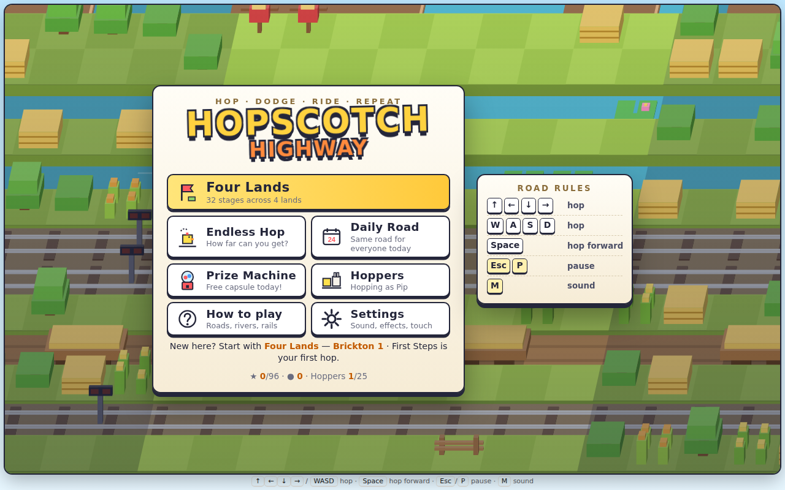
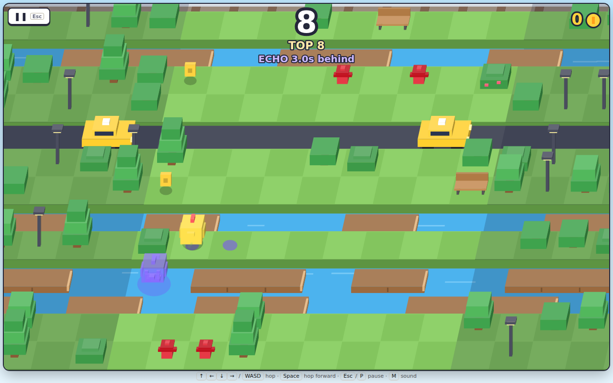
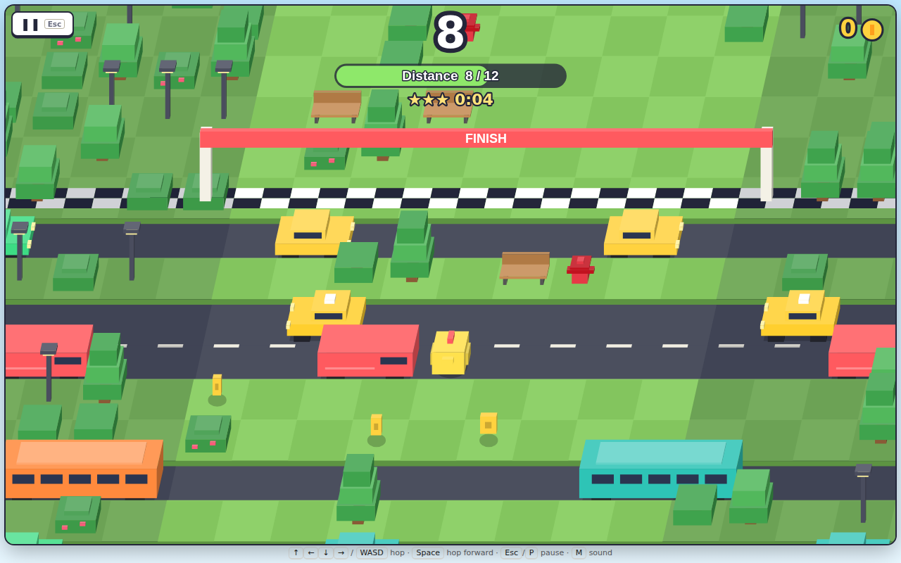
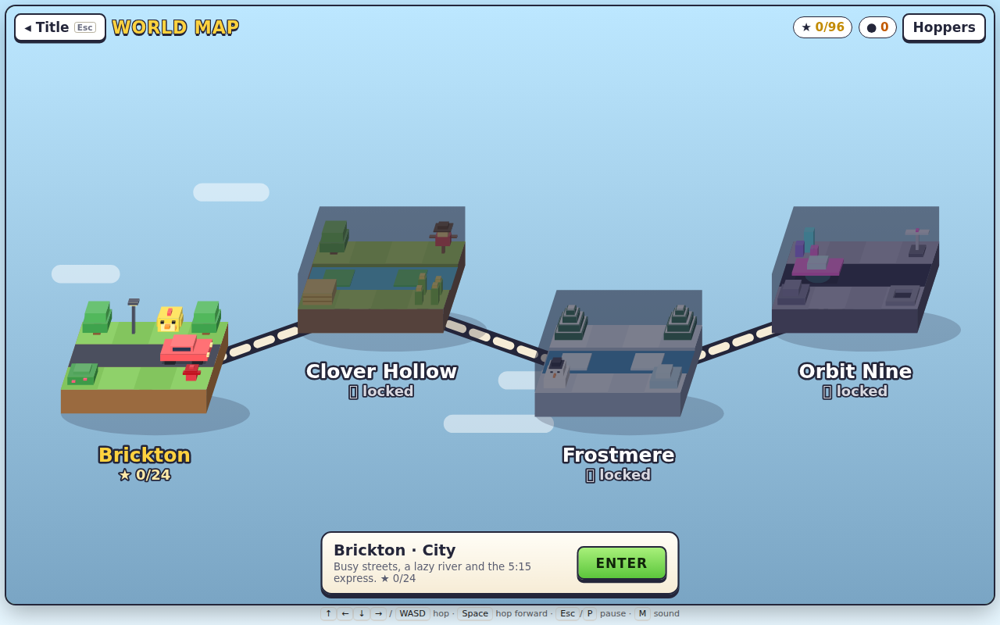
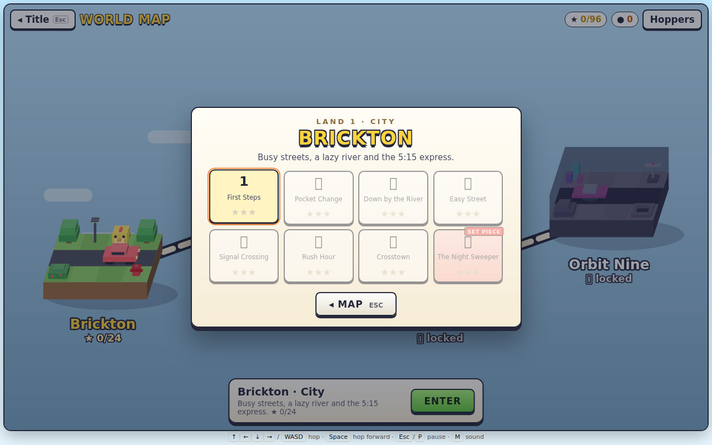
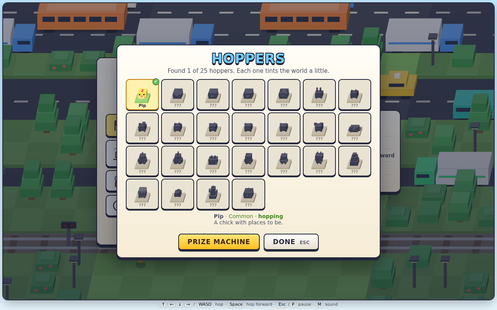
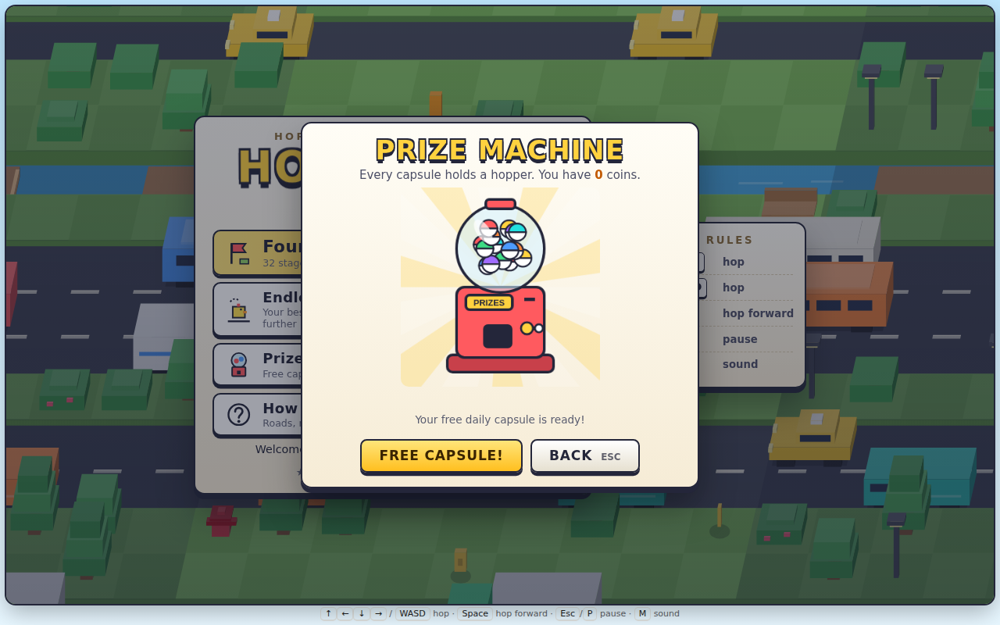

# Hopscotch Highway

**Hop the endless highway: roads, rivers, rails and a hawk that hates waiting. Four lands, 32 stages, 25 hoppers.**

<p align="center">
  
</p>

<p align="center">
  <a href="https://ai-llm-2030.github.io/TrueMarch_Games_Hopscotch_Highway/"><b>▶ Play Hopscotch Highway in your browser</b></a>
</p>

## What's new: Echo Road

A new endless mode where you race your own past. Every hop you make is replayed by your **echo**, a purple ghost of your hopper, 3 seconds later. It walks straight through cars, trains and water; if it lands on you, the run is over. The further you get, the closer it follows (3.0 s down to 1.4 s), so you can no longer simply stand and wait for a gap: hop sideways and back to buy time. Glowing prints on the road show where it steps next, and they turn red just before it gets there.

Try it: on the title choose **Echo Road** (arrow keys + Enter, or tap), then **Hop in**. Hop with ↑ ← ↓ → / W A S D / Space, or tap and swipe on a phone. Your Echo Road best is kept separately from Endless Hop.

<p align="center">
  
</p>

## Gameplay

<p align="center">
  
</p>

## More screenshots

<table>
<tr><td width="50%"><br><sub>The world map: four lands</sub></td><td width="50%"><br><sub>Brickton's stages</sub></td></tr>
<tr><td width="50%"><br><sub>25 hoppers to collect</sub></td><td width="50%"><br><sub>The Prize Machine</sub></td></tr>
</table>

## Controls

| Keys | Action |
|---|---|
| ↑ ← ↓ → or W A S D | Hop |
| Space | Hop forward |
| Esc / P | Pause |
| M | Sound on / off |

## Run it yourself

No install, no build step, no server code, no network. The game runs entirely in your browser and keeps your progress in the browser's local storage.

```bash
git clone https://github.com/ai-llm-2030/TrueMarch_Games_Hopscotch_Highway.git
cd TrueMarch_Games_Hopscotch_Highway
python3 -m http.server 8000
# open http://localhost:8000
```

Opening `index.html` directly works too in most browsers; a local server is the most reliable way.

## What's inside

```
TrueMarch_Games_Hopscotch_Highway/
├── index.html        the whole game: one file, plain JavaScript and <canvas>
├── lib/
│   ├── arcade.js     shared helpers: crisp canvas, frame loop, input, theme
│   └── arcade.css    shared look
├── assets/           the pictures in this README
├── LICENSE
└── README.md
```

Written from scratch in vanilla JavaScript: every sprite, background and sound is drawn or synthesised in code (Canvas 2D and the Web Audio API). No libraries, no frameworks, no third-party assets.

## About

**Hopscotch Highway** is one of the 120+ games made by **[TrueMarch](https://truemarch.com)**. This repository is the standalone single-player edition of the game.

## License

© 2026 TrueMarch. All rights reserved. The source is published so you can read it, learn from it and play the game; see [LICENSE](LICENSE).
